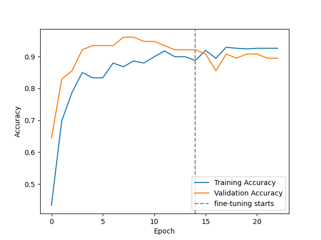
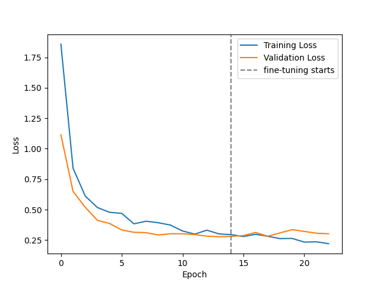
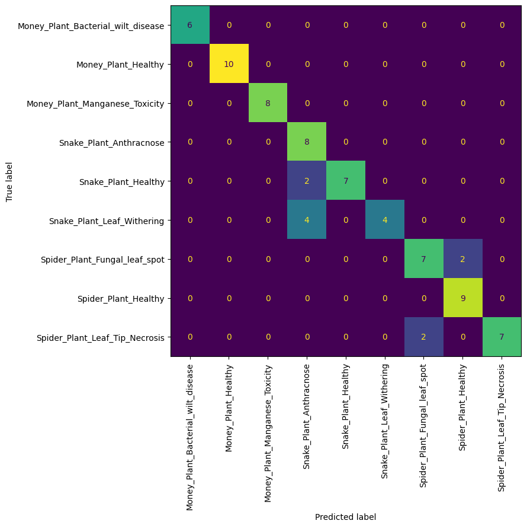
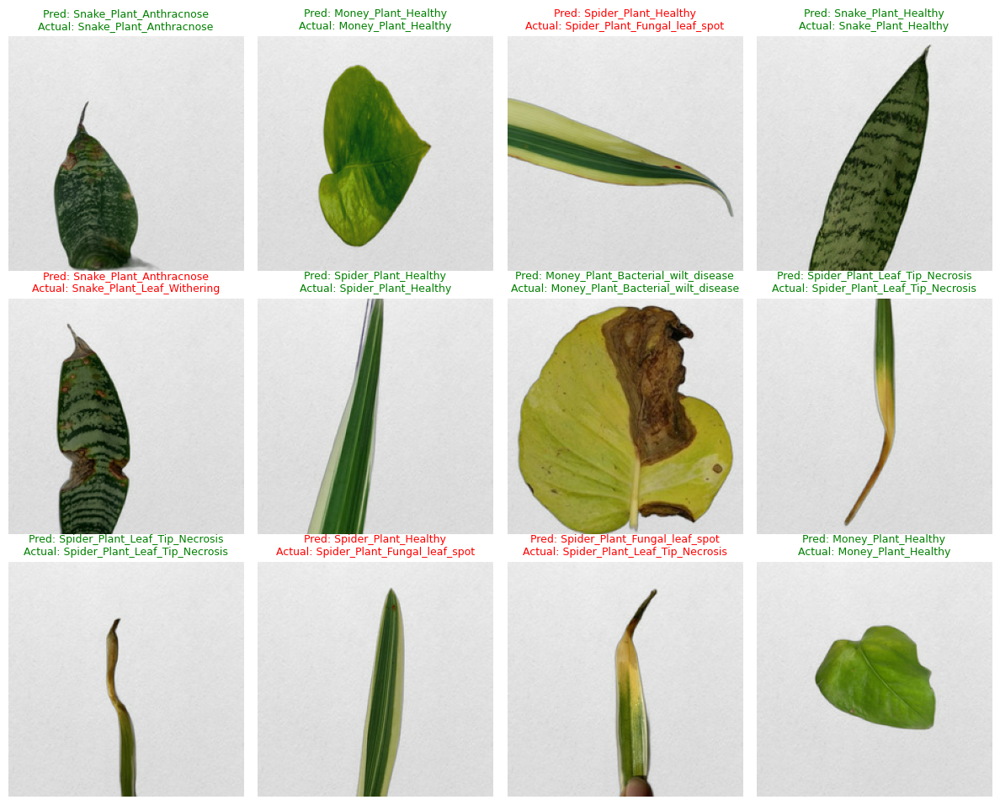

# Indoor Plant Leaf Disease Classification (MobileNetV2 Transfer Learning)

A deep learning pipeline that classifies leaf images of three indoor plants (Money Plant, Snake Plant, Spider Plant) into **9 health conditions**, using transfer learning with **MobileNetV2** (TensorFlow / Keras).

| Item | Value |
|---|---|
| Task | 9-class image classification |
| Backbone | MobileNetV2 (ImageNet weights) |
| Input size | 224 × 224 × 3 |
| Training strategy | Two-phase: train head, then fine-tune the top of the backbone |
| Test accuracy | **86.84 %** (66 / 76 images) |
| Framework | TensorFlow / Keras, scikit-learn |

---

## Classes

| Plant | Conditions |
|---|---|
| Money Plant | Bacterial Wilt Disease, Healthy, Manganese Toxicity |
| Snake Plant | Anthracnose, Healthy, Leaf Withering |
| Spider Plant | Fungal Leaf Spot, Healthy, Leaf Tip Necrosis |

---

## 1. Data Preparation

All steps are in the notebook, in this order.

### 1.1 Loading and cleaning
- Images are read from a `raw_dataset/` folder with one sub-folder per class.
- **Corrupt file check:** every image is opened and verified with PIL (0 corrupt files found).
- **Exact-duplicate removal:** every file is hashed with MD5 and repeated copies are dropped. This matters because a duplicate that lands in both train and validation/test would leak data and inflate the scores. **29 duplicates were removed**.
- Result: **758 valid images** across 9 classes.

| Class | Images |
|---|---|
| Money_Plant_Bacterial_wilt_disease | 59 |
| Money_Plant_Healthy | 93 |
| Money_Plant_Manganese_Toxicity | 80 |
| Snake_Plant_Anthracnose | 81 |
| Snake_Plant_Healthy | 89 |
| Snake_Plant_Leaf_Withering | 86 |
| Spider_Plant_Fungal_leaf_spot | 87 |
| Spider_Plant_Healthy | 92 |
| Spider_Plant_Leaf_Tip_Necrosis | 91 |

The classes are fairly balanced; the smallest is Bacterial Wilt (59 images).


### 1.2 Stratified train / validation / test split
- Split **80 / 10 / 10** with `train_test_split(..., stratify=label, random_state=42)`, done in two stages.
- Stratification keeps the class ratio almost identical in every split.
- Files are copied into `train/`, `val/` and `test/` folders (one sub-folder per class), and a `split_manifest.csv` records which image went where.

| Split | Images |
|---|---|
| Train | 606 |
| Validation | 76 |
| Test | 76 |

### 1.3 Input pipeline
- Loaded with `image_dataset_from_directory`: resized to 224 × 224, batch size 32, integer labels.
- Train data is shuffled; validation and test data are **not** shuffled, so predictions line up with labels.
- **Class names are read from the folder names** (not typed by hand), which keeps labels and the output layer consistent.
- Datasets are cached and prefetched for speed.
- Pixels stay in the 0–255 range in the dataset; scaling to MobileNetV2's expected [-1, 1] range happens **inside the model** (`Rescaling(1/127.5, offset=-1)`).
- A sanity-check cell prints the pixel range and label values and plots a few labelled images.

### 1.4 Data augmentation (applied inside the model, training only)
Random horizontal and vertical flip, rotation (±15 %), zoom (20 %), translation (10 %), contrast (20 %) and brightness (15 %).

---

## 2. Model

```
Input (224×224×3)
 → Data augmentation (training only)
 → Rescaling (0–255 → [-1, 1])
 → MobileNetV2 backbone (ImageNet weights, include_top=False)
 → GlobalAveragePooling2D
 → Dropout(0.3)
 → Dense(128, ReLU, L2=1e-4)
 → BatchNormalization
 → Dropout(0.4)
 → Dense(9, softmax, L2=1e-4)
```

- Total parameters: 2,423,625. In phase 1 only **165,385** are trainable (the new head); the backbone is frozen.
- Optimizer: **AdamW** (weight decay 1e-4). Loss: sparse categorical cross-entropy.

### Two-phase training
| Phase | What is trained | Learning rate | Epochs |
|---|---|---|---|
| 1. Head training | New classifier head only (backbone frozen) | 1e-3 | up to 15 |
| 2. Fine-tuning | Last 40 backbone layers + head (backbone BatchNorm kept frozen) | 1e-5 | up to 20 more |

Callbacks in both phases: `EarlyStopping` (patience 5, restores the best weights by validation loss), `ReduceLROnPlateau` (factor 0.3, patience 2) and `ModelCheckpoint`.

---

## 3. How Overfitting (and Training Failure) Occurred

The first version of this project used a small CNN trained from scratch. Its plot showed **training and validation loss almost identical and flat** (about 2.19 for the whole run). That is not classic overfitting: 2.197 = ln(9) is the loss of a model that outputs the same probability for all 9 classes, meaning the model **was not learning at all**. Overfitting was a second risk that came from the nature of the data.

**Why the early model failed to learn**
- **Unscaled input:** the images reached the model as raw 0–255 pixels, because the preprocessing objects (`ImageDataGenerator`, `preprocess_input`) were defined but never used.
- **Learning rate too high:** `0.01` with Adam made the first epoch unstable (the loss started at about 5.7) and the network collapsed to a constant output.
- **Augmentation never applied:** the augmentation layers were listed but not connected to the model.
- **Wrong class names:** a hand-written list had a duplicate entry (10 names for 9 classes), which mislabelled everything after index 3 in plots and reports.

**Why overfitting is a real risk on this dataset**
- Only **606 training images** for 9 classes, while a CNN trained from scratch has far more parameters than the data can support, so it can memorise instead of generalise.
- **Duplicate images** (29 found) could leak between splits and make validation look better than it is.
- Many leaf diseases look alike, so a model can latch onto background or lighting cues rather than lesions.

---

## 4. How Overfitting Was Reduced

| Technique | Where | Why it helps |
|---|---|---|
| **Transfer learning** (MobileNetV2, ImageNet) | Backbone | Reuses general visual features, so only a small head must be learned from 606 images |
| **Frozen backbone first**, then fine-tune | Two-phase training | Protects pretrained weights from large, noisy updates |
| **Low fine-tuning LR (1e-5)**, backbone BatchNorm frozen | Phase 2 | Gentle adaptation without destroying pretrained features |
| **Data augmentation** | Inside the model | Shows a different version of each image every epoch |
| **Dropout** (0.3 and 0.4) | Head | Stops units from co-adapting |
| **L2 regularization** + **AdamW weight decay** | Dense layers / optimizer | Penalises large weights |
| **Batch Normalization** | Head | Stabilises and regularises training |
| **EarlyStopping** (restore best weights) | Callback | Stops when validation loss stops improving; fine-tuning stopped at epoch 23 of 35 |
| **ReduceLROnPlateau** | Callback | Lowers the learning rate when progress stalls |
| **Duplicate removal + stratified split** | Data preparation | Prevents leakage and keeps class ratios equal across splits |
| **Fixed pixel scaling and sensible LR** | Preprocessing / optimizer | Fixes the collapse to ln(9) so the model actually learns |

---

## 5. Results

### Summary

| Metric | Value |
|---|---|
| Best training accuracy | 92.90 % (epoch 18) |
| Best validation accuracy | 96.05 % (epoch 8) |
| **Test accuracy** | **86.84 %** (66 / 76) |
| Test loss | 0.3808 |
| Macro precision / recall / F1 (test) | 0.907 / 0.870 / 0.869 |

The model went from stuck at chance level (loss ≈ 2.197) to a working classifier. Training and validation accuracy stay close together (about 0.89–0.93 vs 0.89–0.96) and the validation loss does not rise as training continues, so there is no strong overfitting in the curves. Training accuracy is measured with augmentation and dropout switched on, which is why it can sit below validation accuracy.

### Accuracy curve
> Dashed line = start of fine-tuning.



### Loss curve


### Confusion matrix (test set)


### Per-class test results

| Class | Precision | Recall | F1 | Support |
|---|---|---|---|---|
| Money_Plant_Bacterial_wilt_disease | 1.000 | 1.000 | 1.000 | 6 |
| Money_Plant_Healthy | 1.000 | 1.000 | 1.000 | 10 |
| Money_Plant_Manganese_Toxicity | 1.000 | 1.000 | 1.000 | 8 |
| Snake_Plant_Anthracnose | 0.571 | 1.000 | 0.727 | 8 |
| Snake_Plant_Healthy | 1.000 | 0.778 | 0.875 | 9 |
| Snake_Plant_Leaf_Withering | 1.000 | 0.500 | 0.667 | 8 |
| Spider_Plant_Fungal_leaf_spot | 0.778 | 0.778 | 0.778 | 9 |
| Spider_Plant_Healthy | 0.818 | 1.000 | 0.900 | 9 |
| Spider_Plant_Leaf_Tip_Necrosis | 1.000 | 0.778 | 0.875 | 9 |

### Where the model makes mistakes (10 errors out of 76)
- **Snake Plant:** 4 Leaf Withering and 2 Healthy images were predicted as **Anthracnose**. This is the biggest weakness.
- **Spider Plant:** 2 Fungal Leaf Spot images were predicted as Healthy, and 2 Leaf Tip Necrosis images were predicted as Fungal Leaf Spot.
- All three **Money Plant** classes were classified perfectly.

### Sample predictions


### Limitations
- The validation and test sets have only **76 images each**, so one image is worth about 1.3 % accuracy. The 96 % validation vs 87 % test difference is partly noise and partly the model being chosen on the small validation set. Treat the test number as an estimate with a wide margin (roughly ±8 %).
- Splitting is done at image level; several photos of the same leaf would count as separate images, which could make results look better than they are.

---

## 6. Project Structure and Usage

```
.
├── plant-disease-detection.ipynb   # full pipeline: data prep → training → evaluation
├── assets/                         # figures used in this README
└── plant_disease_mobilenetv2.keras # saved model (created by the notebook)
```

1. Put the dataset in a folder named `raw_dataset/` (one sub-folder per class). The notebook looks for it under `/kaggle/input`; change `INPUT_ROOT` to run elsewhere.
2. Run the notebook top to bottom. A GPU is recommended; ImageNet weights are downloaded on first run, so internet access is required.
3. Load the trained model:

```python
import tensorflow as tf
model = tf.keras.models.load_model("plant_disease_mobilenetv2.keras")
# input: float images of shape (224, 224, 3) with raw 0-255 pixel values (scaling is inside the model)
```

## Requirements
`tensorflow`, `numpy`, `pandas`, `matplotlib`, `scikit-learn`, `Pillow`

## Possible improvements
Larger dataset (especially for Snake Plant Leaf Withering vs Anthracnose), leaf cropping / background removal, higher input resolution, a larger backbone, k-fold cross-validation for a more reliable estimate, and test-time augmentation or model ensembling.
